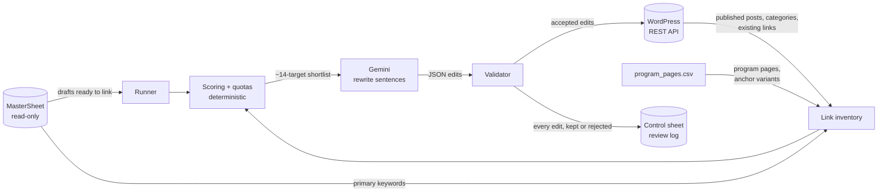

# Varsity Internal Linker

Automated contextual internal linking for the [InterviewBit Varsity blog](https://www.interviewbit.com/varsity/blog/).
Writers submit articles through a Google Sheet; an existing automation turns them into WordPress drafts.
This job picks up those drafts, decides which pages each one should link to, has an LLM lightly rewrite a
few sentences so the links read naturally, validates every edit, and updates the draft before an editor
publishes it.

It runs on a schedule in GitHub Actions: no server, no n8n instance, and a full review log.

## How it works



**Code decides *what* to link; the LLM only decides *how to phrase it*.** The model never sees the whole
site, never writes HTML, and can't introduce a URL that the scorer didn't shortlist.

### 1. Link inventory
Rebuilt every run from live sources, so a newly published post becomes a link target automatically:
- published posts from the WordPress REST API (URL, title, categories, outbound links)
- each post's primary keyword from the MasterSheet, plus its title phrase, as anchor variants
- program landing pages and their anchor variants from `config/program_pages.csv` (see below)
- inbound-link counts per URL, computed from every published post's content

### Program pages file
`config/program_pages.csv` is the one place to add, pause or remove program landing pages. Edit it in
GitHub's web editor (it renders as a table); the next run picks it up.

| Column | Meaning |
|---|---|
| `id` | short unique name, e.g. `fde` |
| `active` | `yes` to link to it, `no` to pause without deleting |
| `name` | program name (shown to the LLM) |
| `url` | landing page URL; tracking parameters are stripped automatically |
| `categories` | WordPress categories this program "owns", separated by `\|` (exact WP names) |
| `anchors` | anchor-text ideas, most preferred first, separated by `\|` |

A program with no categories is still a link target, but only where it's highly relevant.

### 2. Weightage function

```
score = W_type × W_category × (0.3 + 0.7 × relevance) + orphan_boost
```

| Factor | Values |
|---|---|
| `W_type` | program landing page 1.0 · pillar 0.7 · blog 0.5 |
| `W_category` | same WP category 1.0 · adjacent category 0.4 · other 0.1 |
| `relevance` | 1.0 if a keyword variant appears verbatim in the draft, 0.7 if all its words share a sentence, else topical token overlap |
| `orphan_boost` | up to +0.3 for pages with few inbound links, decaying to 0 at 5 links |

Hard exclusions: the post itself, pages it already links to, and pages targeting the same primary
keyword (cannibalisation guard).

### 3. Quotas
- Link budget: about 1 internal link per 275 words, clamped to 3–8 **in total, including links the writer already added**.
- The post's own program page is **required** (min 1, max 2 program links).
- At least 60% of blog links come from the post's own WP category.

All weights and quotas live in `config/settings.yaml`.

### Link hygiene (writer-added links)
Writers often add their own links. Every existing link in the post is read first and classified as
**internal** (Varsity blog or program page) or **external**, with relative URLs resolved.
- Existing internal links **count toward the article's total budget**: new links = budget − existing
  internal. External links can be counted too (`count_external_in_budget`).
- Existing program-page links count toward the program quota.
- Pages the post already links to are never linked again.
- No new link in a sentence that already has one, or in the sentence directly before or after
  (`min_sentence_gap`). New links also keep that distance from each other.
- At most 1 new link per paragraph and at most 2 links per paragraph in total, counting the
  writer's links (`max_total_links_per_paragraph`).
- A new anchor may not repeat an existing link's anchor text.

### 4. LLM rewrite + validation
Gemini gets the shortlist and a list of sentences it may edit. Excluded from that list: the intro, headings,
FAQ sections/blocks, lists, and any sentence with existing links or inline formatting. It returns JSON
edits; each one must pass:

- known sentence and target IDs, each used at most once
- one link per sentence and per paragraph
- descriptive anchor (2–8 words, no "click here"), present exactly once in the rewrite
- rewrite stays close to the original (token similarity) and adds no new numbers or markup
- total within the link budget

Accepted edits are applied by string surgery on the raw post content, so Gutenberg block markup and all
formatting outside the edited sentence are untouched.

## Safety
- **MasterSheet is never written to**: read-only OAuth scope, and the service account is only a Viewer.
- **Only drafts are edited**: post status is re-checked immediately before every write; published posts are refused.
- **Dry run by default**: proposals go to the review log until `DRY_RUN=false`.
- **Fully reversible**: every update creates a WordPress revision.
- **One bad post can't stop a run**: errors are logged per post.

## Repo layout

```
linker/
  main.py        run orchestration, CLI (--post-id, --dry-run)
  sheets.py      MasterSheet reader (read-only) + control-sheet log
  wordpress.py   REST client: inventory reads, draft-only writes
  inventory.py   link targets + inbound-link counts
  scoring.py     weightage function and quota planner
  content.py     safe-sentence extraction and edit application
  llm.py         Gemini prompt + call
  validate.py    deterministic edit checks
config/          settings.yaml (weights, quotas), program_pages.csv (program pages),
                 categories.yaml (adjacent categories, pillar pages, anchor overrides)
tests/           offline tests incl. an end-to-end run with fake WordPress + LLM
.github/workflows/
  link.yml       scheduled + manual run
  tests.yml      CI
```

## Running

See **[SETUP.md](SETUP.md)** for secrets and the first dry run. Locally:

```bash
pip install -r requirements.txt
python -m pytest -q                    # offline, no credentials needed
export GOOGLE_SERVICE_ACCOUNT_JSON="$(cat key.json)" MASTERSHEET_ID=... CONTROL_SHEET_ID=... \
       WP_USERNAME=... WP_APP_PASSWORD=... GEMINI_API_KEY=...
python -m linker.main --post-id 1940 --dry-run
```

## Roadmap
- Embedding-based relevance (catch paraphrases the keyword matcher misses)
- Anchor-diversity tracking per target across the whole blog
- Reverse linking: suggest older posts that should link to each newly published one

---
Built by Prakhar Jaiswal.
