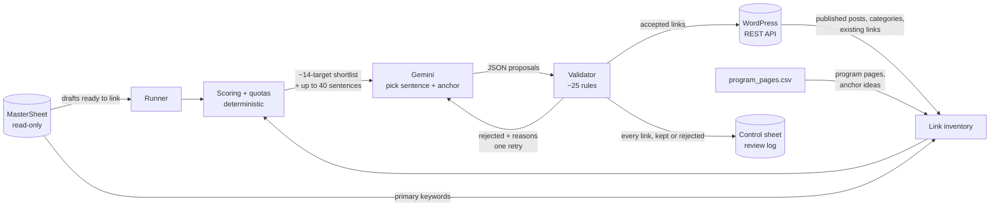

# Varsity Internal Linker

Automated contextual internal linking for the [InterviewBit Varsity blog](https://www.interviewbit.com/varsity/blog/).
Writers submit articles through a Google Sheet; an existing automation turns them into WordPress drafts.
This job picks up drafts that are ready, decides which pages each one should link to, places the links
on words the writer already used, checks every link against strict rules, and updates the draft before
an editor publishes it.

It runs on a schedule in GitHub Actions: no server, no n8n instance, and a full review log.

**In plain words:** code decides *which* pages to link (by category, relevance and priority for
programme pages); Gemini only picks *which sentence and which words* carry each link; a rule checker
throws out anything that changes the writer's meaning. If there's no natural place for a link, the
post simply gets fewer links. Nothing is forced to hit a number.

## How it works



The model never sees the whole site, never writes HTML, and can't introduce a URL the scorer didn't
shortlist. The link tag itself is built by code.

### 1. Link inventory
Rebuilt every run from live sources, so a newly published post becomes a link target automatically:
- published posts from the WordPress REST API (URL, title, categories, outbound links)
- anchor ideas per post: its primary keyword from the MasterSheet plus the topic part of its title
  ("The Hadamard Gate Explained Better Than Your Textbook" → "hadamard gate")
- program landing pages and their anchor ideas from `config/program_pages.csv`
- inbound-link counts per URL, computed from every published post's content

### 2. Choosing pages: weightage function

```
score = W_type × W_category × (0.3 + 0.7 × relevance) + orphan_boost
```

| Factor | Values |
|---|---|
| `W_type` | program landing page 1.0 · pillar 0.7 · blog 0.5 |
| `W_category` | same WP category 1.0 · adjacent category 0.4 · other 0.1 |
| `relevance` | 1.0 if a keyword appears verbatim in the article, 0.7 if all its words share a sentence, else topical overlap |
| `orphan_boost` | up to +0.3 for pages with few inbound links, decaying to 0 at 5 links |

**Never linked:** the post itself; pages it already links to; pages targeting the same primary keyword
(cannibalisation guard); a second page on the same sub-topic (e.g. both "Hadamard Gate" and "Quantum
Gates: From Hadamard to CNOT"). Blog pages with very low relevance are dropped.

### 3. Quotas (a ceiling, not a target)
- Budget: about 1 internal link per 275 words, 3–8 **in total**. The writer's existing internal links
  count toward it (each page once; image/banner links don't count). New links = budget − existing.
- The post's own programme page gets one "required" slot (max 2 programme links). Required means
  "try first", not "force": if no sentence fits, it's skipped and logged.
- At least 60% of blog links come from the post's own WordPress category.

All weights and quotas live in `config/settings.yaml`.

### 4. Gemini's job, and the wording rules
Gemini receives the shortlist and up to 40 sentences it may use. Never offered: intro, headings, lists,
tables, FAQ sections, sentences with formatting, and sentences that already have a link or sit next to one.

- **Blog links: the writer's words, unchanged.** The anchor must be text already in the sentence; the
  sentence is not rewritten. If no sentence mentions a page's topic, that page is skipped.
- **Programme links: insert only.** A short phrase (≤ 6 words) may be inserted, but only in a
  sentence already about learning/courses/certifications/careers or the programme's topic, and
  nothing of the writer's (words or punctuation) may be changed or removed.

### 5. Validation (deterministic)
Every proposal is checked; failures are dropped and logged with a reason. Highlights:
- the wording rules above; no new numbers, markup or punctuation-only edits
- anchors: 2–8 words (or one distinctive term that *is* the target's topic, e.g. "RLHF"); no filler
  starts ("On…", "parts of…"); must describe the target page; must not use the article's own topic
  for another page; one link per term per article; no near-identical anchors
- spacing: one link per sentence, never in or next to a linked sentence, ≤ 1 new and ≤ 2 total links
  per paragraph
- within the budget

If anything is rejected, Gemini gets **one** retry with the reasons. Whatever survives is final.
Accepted links are applied by string surgery on the raw post, so Gutenberg blocks and all other
formatting are untouched.

### Link hygiene and findings
- Existing links are classified internal (Varsity blog / programme pages) or external.
- Reports flag posts where the writer linked the same page several times, and WordPress categories
  missing from `config/categories.yaml`.

### Working alongside people
- **Never overwrites someone's save:** the post's "last modified" stamp is recorded when it's read and
  checked again right before saving. If anyone saved in between (or the status changed), nothing is
  written; the post is logged `retry_later` and picked up on the next run from their version.
- **Waits while someone is editing:** a draft saved in the last 10 minutes (`run.cooloff_minutes`) is
  skipped until the next run. Drafts the MasterSheet just created are exempt when the instant trigger
  names them.
- **Notices removed links:** once a linked post is published (and an hour has passed), the bot records
  in **Link Checks** how many of its links survived editing. It never re-adds removed links.
- **Instant trigger:** the MasterSheet's Apps Script can start a run the moment it creates drafts
  (`apps_script/trigger_internal_linker.gs`), instead of waiting up to 30 minutes for the schedule.

### Reliability
- Gemini: `gemini-3.8-flash` with low thinking, 5-minute deadline, 2 retries on 429/5xx, then
  fallback models (`gemini-3.6-flash`, `gemini-3.5-flash-lite`).
- WordPress: posts fetched in light pages with retries; if article bodies can't be read, the run
  continues without inbound counts.
- One bad post can't stop a run.

## Program pages file
`config/program_pages.csv` is the one place to add, pause or remove programme landing pages. Edit it in
GitHub's web editor (it renders as a table); the next run picks it up.

| Column | Meaning |
|---|---|
| `id` | short unique name, e.g. `fde` |
| `active` | `yes` to link to it, `no` to pause without deleting |
| `name` | programme name (shown to the LLM) |
| `url` | landing page URL; tracking parameters are stripped automatically |
| `categories` | WordPress categories this programme "owns", separated by `\|` (exact WP names) |
| `anchors` | anchor-text ideas, most preferred first, separated by `\|` |

## Safety
- **MasterSheet is never written to**: read-only OAuth scope, and the service account is only a Viewer.
- **Only drafts are edited** by the scheduled linker: status is re-checked right before every write.
  Published posts are edited only by the *Backfill* workflow, and only when its dry run is unticked.
- **No lost edits**: a save is refused if the post changed since it was read (see above).
- **Preview and audit can't edit anything**: the audit workflow doesn't receive WordPress credentials.
- **Dry run until switched**: with `DRY_RUN=true` proposals only go to the control sheet.
- **Fully reversible**: every update creates a WordPress revision ("Internal Linker" user).

## Workflows

| Workflow | What it does | Changes WordPress? |
|---|---|---|
| **Internal linker** | Every 30 min, Mon–Sat 09:30–21:00 IST, and instantly when the MasterSheet signals new drafts: links drafts marked *Ready to Publish* that have a Draft Link. Manual runs can target one post ID. | Only when `DRY_RUN=false`, only drafts |
| **Backfill published posts** | Adds links to already-live posts in small batches: specific URLs or "next N" not yet done. Dry run by default. | Only with *dry run* unticked |
| **Preview on a post** | One post (URL, edit link or ID) → before/after `preview.html` | Never |
| **Audit live posts** | Random sample or chosen URLs → control-sheet tabs *Audit Summary* / *Audit Links* + before/after pages | Never |
| **Tests** | Offline test suite on every push | Never |

Control sheet tabs: **Processed** (one row per post handled; `mode` = draft or backfill), **Changes**
(one row per link, original vs new sentence), **Link Checks** (did the links survive to publish),
**Audit Summary**, **Audit Links**.

## Repo layout

```
linker/
  main.py        scheduled run orchestration, CLI (--post-id, --dry-run)
  pipeline.py    one-article pipeline shared by runner, preview and audit
  preview.py     safe preview on any post -> before/after HTML report
  audit.py       batch audit of live posts -> control-sheet tabs + reports (read-only)
  backfill.py    add links to published posts in tracked batches (dry run by default)
  sheets.py      MasterSheet reader (read-only) + control-sheet log
  wordpress.py   REST client: inventory reads, draft-only writes
  inventory.py   link targets + inbound-link counts
  scoring.py     weightage function and quota planner
  content.py     safe-sentence extraction, existing-link hygiene, edit application
  llm.py         Gemini prompt, retries, fallback models
  validate.py    deterministic checks on every proposed link
config/          settings.yaml (weights, quotas, rules), program_pages.csv (programme pages),
                 categories.yaml (adjacent categories, pillar pages, anchor overrides)
tests/           offline tests, many built from real preview/audit cases
.github/workflows/  link.yml, backfill.yml, preview.yml, audit.yml, tests.yml
apps_script/     trigger_internal_linker.gs (instant trigger, pasted into the MasterSheet's script)
```

## Running locally

See **[SETUP.md](SETUP.md)** for secrets and going live.

```bash
pip install -r requirements.txt
python -m pytest -q                    # offline, no credentials needed
python -m linker.preview --post https://www.interviewbit.com/varsity/blog/rlhf/   # needs GEMINI_API_KEY
python -m linker.audit --sample 5      # needs Gemini + Google service account + CONTROL_SHEET_ID
python -m linker.main --post-id 1573 --dry-run
python -m linker.backfill --next 3     # dry run; add --live to apply
```

## Roadmap
- Embedding-based relevance (catch paraphrases the keyword matcher misses)
- Anchor-diversity tracking per target across the whole blog
- Reverse linking: suggest older posts that should link to each newly published one
- Writer feedback: flag posts with no natural link opportunities before they're submitted

---
Built by Prakhar Jaiswal.
